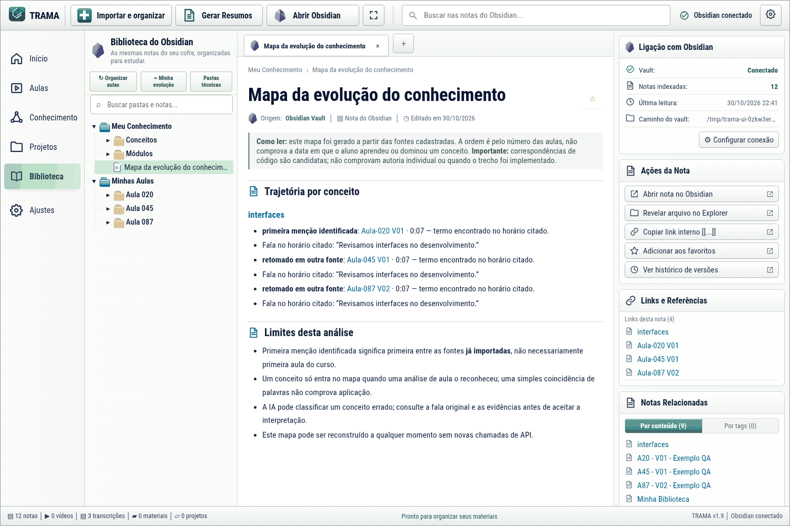
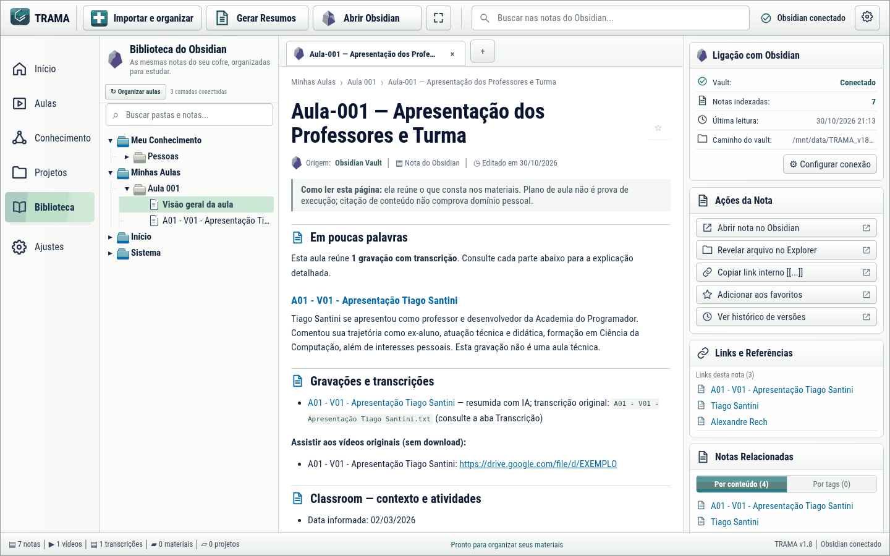

<div align="center">


# TRAMA

### Transforme aulas soltas em uma biblioteca que faz sentido.

**Organize seus estudos, encontre o que o professor ensinou e revise seu código — tudo conectado ao Obsidian.**

[](https://github.com/Marco-Oliver/TRAMA/releases/latest)
[](https://github.com/Marco-Oliver/TRAMA/releases/latest)
[](https://github.com/Marco-Oliver/TRAMA/actions/workflows/release.yml)
[](#-segurança-e-privacidade)

### [⬇️ **BAIXAR TRAMA PARA WINDOWS**](https://github.com/Marco-Oliver/TRAMA/releases/latest/download/TRAMA_Setup.exe)

**Instalador Windows · Não exige Python · Sem configurar terminal**

[Como instalar](#-instalação-em-4-passos) · [Ver as telas](#-conheça-o-trama) · [IA Professor](#-ia-professor-experimental) · [Como atualizar](#-atualizar-sem-complicação)

</div>

---

## 🖥️ Conheça o TRAMA

<figure>

<figcaption><sub>Interface do aplicativo com conteúdo de demonstração utilizado nos testes.</sub></figcaption>
</figure>

<details>
<summary><strong>📚 Ver a Biblioteca do Obsidian</strong></summary>



</details>

O TRAMA não substitui o Obsidian: ele **organiza, conecta e facilita o estudo** sobre os mesmos arquivos Markdown que você já pode abrir e editar normalmente.

## ✨ Tudo num só lugar

| Recurso | O que você consegue fazer |
| :-- | :-- |
| 📚 **Aulas** | Reunir gravações V01/V02/V03, transcrições, arquivos e links na mesma aula. |
| 🧠 **Conhecimento** | Ler resumos por aula e módulo, consultar conceitos e acompanhar a evolução dos estudos. |
| 💻 **Projetos** | Relacionar explicações com arquivos, exemplos de código e linhas dos repositórios Git. |
| 🔗 **Biblioteca** | Navegar pelas notas e conexões diretamente no TRAMA ou abrir o Obsidian. |
| 🔎 **Busca e filtros** | Encontrar aulas e notas; filtrar itens recentes ou favoritos. |
| 🛟 **Dúvidas** | Guardar hipóteses e localizar possíveis evidências em aulas futuras, sem inventar respostas. |
| 💾 **Backup** | Criar um ZIP local verificado e restaurar em outra pasta sem sobrescrever a biblioteca atual. |
| 🎓 **IA Professor** | Conversar sobre as aulas, receber desafios e revisar código com referências ao material encontrado. |

### Como o conteúdo vira conhecimento

```text
     Transcrições · prints · documentos · links · Git
                            │
                     Importar e organizar
                            │
                 Análise opcional por IA
                            │
           Conferência de trechos e relações
                            │
                        OBSIDIAN
            ┌───────────────┼───────────────┐
            ▼               ▼               ▼
           Aulas         Conceitos        Projetos
            └───────────────┼───────────────┘
                            ▼
                     Revisão e estudo
```

**Vídeos permanecem por link:** o TRAMA não baixa automaticamente os arquivos do Classroom ou do Meet. Você seleciona as fontes; o sistema as organiza e preserva suas referências.

## 🎓 IA Professor (experimental)

A IA Professor lê **trechos selecionados das notas do cofre** e solicita uma resposta ao provedor externo que você configurar. O Python faz a busca e prepara o contexto; **não é um modelo treinado pelo TRAMA**.

- **Explicar / revisar:** faça uma pergunta e confira as notas utilizadas.
- **Criar desafios:** pratique somente assuntos encontrados na sua biblioteca.
- **Corrigir meu código:** cole um trecho e peça pistas sobre erros, sem executar o programa.

As respostas mostram referências clicáveis. Se não houver material correspondente, o Professor informa que falta contexto em vez de escolher um assunto não relacionado.

**Privacidade:** o chat é temporário, o Professor não escreve no Obsidian e o envio de cada pergunta exige autorização. Algumas informações podem ser enviadas à API externa; remova dados privados antes de enviar.

**Qualidade:** as citações confirmam *quais notas foram consultadas*, mas não comprovam que o modelo interpretou tudo corretamente. Uma conversa com modelo simulado não substitui avaliação com modelo real.

## 📦 Instalação em 4 passos

<details open>
<summary><strong>Quero só usar o aplicativo (não sou desenvolvedor)</strong></summary>

1. Clique em **[Baixar TRAMA para Windows](https://github.com/Marco-Oliver/TRAMA/releases/latest/download/TRAMA_Setup.exe)**.
2. Abra o arquivo **`TRAMA_Setup.exe`**, siga as telas do instalador e, ao terminar, abra **TRAMA** pelo menu Iniciar.
3. Na aba **Ajustes**, clique em **Selecionar pasta do Obsidian**. Pode escolher um cofre existente ou um cofre preparado para seus estudos.
4. Clique em **Importar e organizar**, adicione suas transcrições, prints e links, confira a fila e selecione **Processar tudo**.

**Não precisa:** clonar GitHub, instalar Python, rodar comandos, configurar Docker ou baixar um ZIP com código-fonte.

</details>

> **Aviso do Windows:** o instalador ainda não tem assinatura digital. O Windows pode alertar sobre aplicativos de editor não reconhecido. Confira sempre que o download veio da [release oficial](https://github.com/Marco-Oliver/TRAMA/releases/latest) e valide o SHA-256 disponibilizado no mesmo release. Não execute um arquivo cuja origem você não consiga verificar.

### 🔄 Atualizar sem complicação

Dentro do TRAMA:

1. Entre em **Ajustes → Verificar atualizações**.
2. Se houver versão nova, clique em **Baixar e instalar nova versão**.
3. O TRAMA baixa o instalador do canal oficial e confere seu **SHA-256**. Você confirma antes de executar a instalação.
4. Reabra o TRAMA e selecione seu cofre, se necessário.

O instalador de uma versão nova **não substitui nem desinstala seu Obsidian**. Recomendamos criar um backup antes de atualizar: **Ajustes → Criar backup local (.zip)**. Para recuperação, escolha **Restaurar backup em nova pasta**.

Caso o verificador do aplicativo esteja indisponível, baixe manualmente pela [página de releases](https://github.com/Marco-Oliver/TRAMA/releases/latest).

**Importante:** a atualização não é automática nem silenciosa; depende de você. O teste automatizado de upgrade valida cofres de demonstração e não substitui a conferência da sua biblioteca real.

## 🔐 Segurança e privacidade

| Dados | Tratamento |
| :-- | :-- |
| Notas e transcrições | Arquivos locais no cofre escolhido. |
| Banco de dados | SQLite local para catalogar fontes, resumos e histórico. |
| Chaves de IA | Configuradas localmente; no Windows, protegidas com DPAPI. |
| IA externa | Só recebe contexto quando você autoriza; valem as políticas do provedor. |
| Código do estudante | Não é executado pela IA Professor. |
| Backup | ZIP com verificação de arquivos, **não criptografado**. Guarde com cuidado. |

O TRAMA aceita provedores opcionais como Gemini, Groq e OpenRouter, sujeitos aos termos e cotas de cada serviço. **ChatGPT Plus e Claude Pro não equivalem a chaves de API gratuitas**; o TRAMA não consegue verificar ou bloquear faturamento de terceiros.

O sistema tenta ocultar formatos comuns de credenciais, mas nenhuma filtragem garante detectar todos os dados sensíveis. Evite importar materiais com senhas, segredos ou informações pessoais desnecessárias.

Leia também [SECURITY.md](SECURITY.md) e a [documentação completa do produto](PLANEJAMENTO_TRAMA.md).

## 🛠️ Para quem quer desenvolver

<details>
<summary><strong>Arquitetura, testes e execução a partir do código-fonte</strong></summary>

| Parte | Tecnologia |
| :-- | :-- |
| Interface desktop | HTML, CSS, JavaScript e pywebview/WebView2 |
| Automação | Python 3.11+, Git e SQLite |
| Conhecimento | Markdown e links internos do Obsidian |
| IA (opcional) | API externa configurada pelo usuário |
| Instalador | PyInstaller e Inno Setup |
| Validação | unittest, cenários adversariais, GitHub Actions e testes automatizados de interface |

```powershell
python -m pip install -r requirements.txt
python -m unittest discover -s tests -q
python qa_adversarial.py
python main.py gui
```

A auditoria completa inclui **personagens fictícios**, testes de segurança, fluxo de telas em navegador automatizado e compilação/instalação do executável Windows. Testes simulados não são avaliação de qualidade de um Gemini real.

Veja os workflows na pasta [`.github/workflows`](.github/workflows).

</details>


## 🧪 TRAMA 2.2.0 — em desenvolvimento

> **A versão estável disponível no botão de download continua sendo a 2.1.0.**
> As funcionalidades abaixo estão na [PR de desenvolvimento #5](https://github.com/Marco-Oliver/TRAMA/pull/5);
> não há instalador oficial 2.2.0 publicado.

**O coração do TRAMA é a automação de conhecimento — não a IA Professor.**
A proposta é importar algumas aulas por dia e deixar a biblioteca do Obsidian
cada vez mais completa. A IA Professor é uma maneira adicional de consultar esse
conteúdo, mas você também pode usar o Obsidian com outras IAs compatíveis.

| Prioridade | Evolução em construção |
| :-- | :-- |
| 📥 **Importação incremental** | Acrescentar transcrições, imagens, links e repositórios sem reanalisar todas as aulas anteriores. |
| 📖 **Resumos didáticos** | Explicações fiéis à aula, indicação de lacunas e alertas para resumos superficiais, sem novas chamadas desnecessárias. |
| 🧷 **Dúvidas antigas** | Quando a Aula 050 explica uma questão aberta na Aula 031, anexar a evidência apenas à dúvida relevante — sem inventar confirmação. |
| 💻 **Código do GitHub** | Distribuir evidências entre arquivos e conceitos; links verificáveis para arquivo, commit e linha. |
| 🔎 **Busca no Obsidian** | Buscar dentro do texto Markdown e mostrar trechos correspondentes, localmente. |
| 🖥️ **Interface clássica** | Janela própria para GitHub, avisos e confirmações legíveis, sem CMD espontâneo, cópia nativa de wikilinks e botões claros. |
| 🔐 **Privacidade** | Autorização local e revogável nos Ajustes para operações de IA que você iniciar. |
| 💾 **Integridade** | Backups com caminhos longos, proteção de notas editadas e favoritos persistentes. |

**Limitações mantidas:** o aplicativo não baixa vídeos privados do Classroom
nem lê automaticamente conteúdos de Drive restritos. URLs ficam registradas
como fontes, mas só arquivos efetivamente importados ou código Git indexado
podem fundamentar análises. Nenhuma IA deve inventar o que o professor disse.

**Critérios de liberação:** testes automáticos Linux e Windows, integridade do
instalador Windows, restauração isolada, revisão visual e avaliação de resumos
com materiais apropriados. Veja o [plano de validação v2.2.0](docs/TRAMA_V220_PLANO_E_VALIDACAO.md).

---

## 🛡️ O que muda na atualização 2.1.0

A nova versão reúne as melhorias da IA Professor, o estudo de transcrições originais e os ajustes de segurança desde a 2.0.1:

- **IA Professor com evidências:** usa, mediante autorização, trechos verificados do TXT original e referências às notas do Obsidian; não trata citações como prova de que a resposta esteja correta.
- **Busca em transcrições:** procure termos como `dotnet`, `SDK` e `terminal` na aula, com trechos e horários do arquivo original, sem gastar cota de IA.
- **Resumos mais claros:** distingue nomes/apelidos de conceitos técnicos e marca explicitamente aulas sem análise por IA.
- **Reprocessamento individual:** permite reanalisar uma aula com confirmação, preservando edições manuais e criando propostas quando há conflito.
- **Compatibilidade Windows:** leitura SQLite corrigida e testes de regressão, interface e atualização de instalador.

**Para quem já tem o TRAMA 2.0.1:** use **Ajustes → Verificar atualizações** quando a 2.1.0 aparecer. Não instale a edição Preview separada. O instalador oficial usa a **mesma identidade, pasta e nome** do aplicativo existente e mantém cofre, configurações e chaves locais. Faça o backup do cofre antes de reprocessar aulas. A versão pública atual é indicada pelo selo **Última versão** no topo.


---

<div align="center">

**TRAMA · Seu conhecimento, organizado.**

<sub>Feito para estudar melhor, mantendo seu material no Obsidian e seu controle sobre dados e atualizações.</sub>

</div>


> **Revisão de qualidade:** os testes automatizados usam dados fictícios. As aulas reais e as respostas de um provedor externo ainda precisam de conferência humana, mesmo após a publicação de uma atualização.
